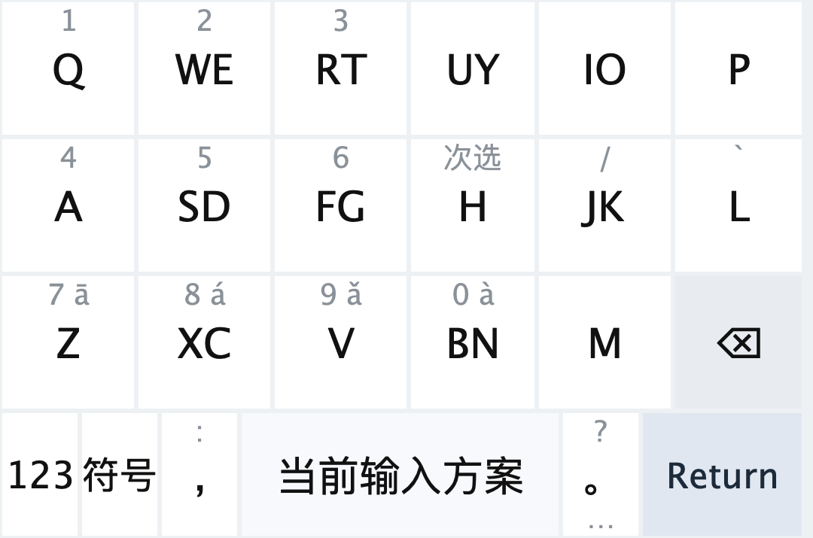
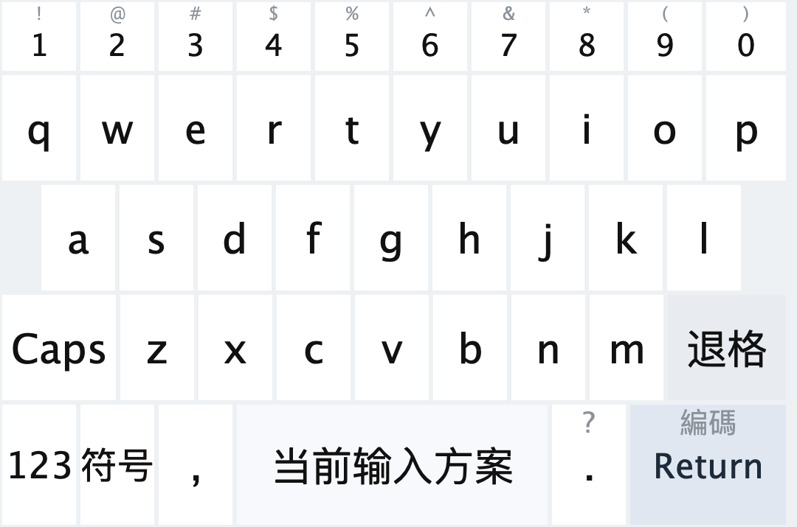
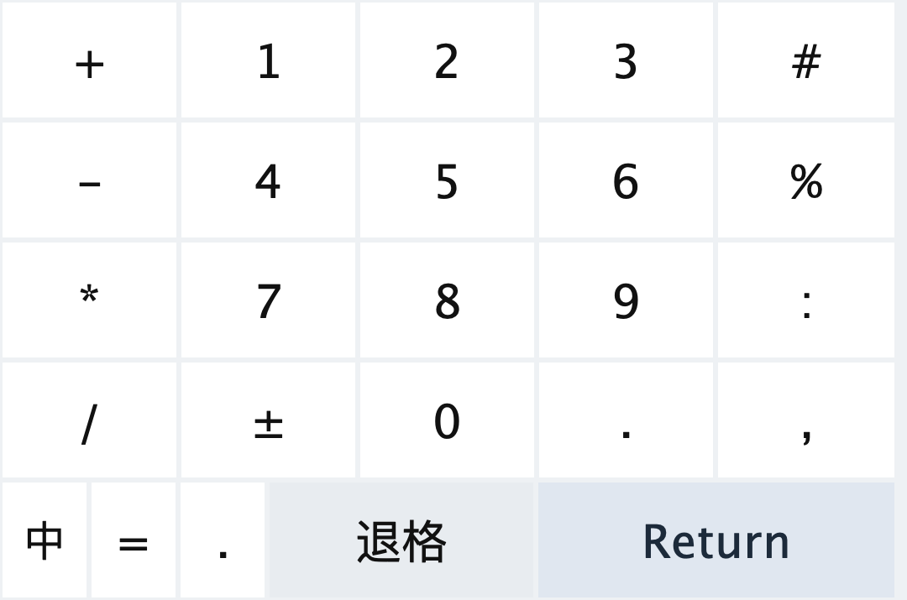
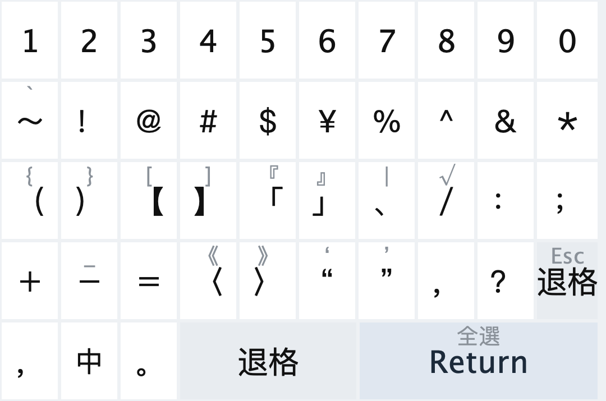

# trime-dual-17keys

一个面向同文输入法（Trime）的 17 键双键皮肤。

这套皮肤本身是通用的，不绑定某个具体输入方案。只要目标方案的 `speller/alphabet` 使用 26 个小写字母，就可以接入仓库中的 [`dual_17keys_algebra.yaml`](./dual_17keys_algebra.yaml)。

这套皮肤已经针对 [`amzxyz/rime_wanxiang`](https://github.com/amzxyz/rime_wanxiang) 做了专门优化，重点适配了：

- 分号次选
- `/` 辅助码
- `` ` `` 反查

## 特性

- 中文主键盘与英文键盘通过空格上滑互相切换
- 英文键盘字母键上滑可临时输入大写字母
- 英文键盘左下角 `Caps` 可锁定大写
- 中文进入的符号页以全角符号为主，英文进入的符号页保留半角符号习惯

## 适用范围

这套皮肤适用于“输入字母表是 26 个小写字母”的方案。

仓库里的 [`dual_17keys_algebra.yaml`](./dual_17keys_algebra.yaml) 目前提供的是通用层：

```yaml
common:
  latin_26:
    __append:
      - derive/...
```

也就是说，它假设你的方案最终是用 26 个小写字母来表达编码，然后通过 `speller/algebra` 去接住这套双键映射。

## 安装

如果你只是想直接下载使用，可以先从 release 获取文件：

- 整包下载（推荐）：[trime-dual-17keys-v0.1.0.zip](https://github.com/nextzhou/trime-dual-17keys/releases/download/v0.1.0/trime-dual-17keys-v0.1.0.zip)
- 单独下载主题文件：[dual_17keys.trime.yaml](https://github.com/nextzhou/trime-dual-17keys/releases/download/v0.1.0/dual_17keys.trime.yaml)
- 单独下载 algebra 文件：[dual_17keys_algebra.yaml](https://github.com/nextzhou/trime-dual-17keys/releases/download/v0.1.0/dual_17keys_algebra.yaml)
- 发布页：[Releases](https://github.com/nextzhou/trime-dual-17keys/releases)

1. 将 [`dual_17keys.trime.yaml`](./dual_17keys.trime.yaml) 放到同文输入法（Trime）/ Rime 用户目录。
2. 将 [`dual_17keys_algebra.yaml`](./dual_17keys_algebra.yaml) 放到同一目录。
3. 在同文输入法（Trime）中选择这个主题。
4. 在你实际使用的输入方案 `*.custom.yaml` 中，把 `dual_17keys_algebra:/common/latin_26` 接入到 `patch/speller/algebra`。
5. 重新部署 Rime。

如果你的方案已经有自己的 `speller/algebra` 配置，不要覆盖原有内容，而是在现有接入链路里继续追加：

```yaml
patch:
  speller/algebra:
    __patch:
      - dual_17keys_algebra:/common/latin_26
```

如果目标方案本来已经在 `__patch` 里引用了其他 algebra 预设，也请保留原有条目，再把 `dual_17keys_algebra:/common/latin_26` 追加到末尾。

## `rime_wanxiang` 额外配置

这套皮肤对 `rime_wanxiang` 做了额外优化，因此如果你使用的是 `wanxiang_pro` / `wanxiang_reverse`，建议按下面方式接入。

万象相关的键位优化如下：

- `H` 上滑输出 `;`，用于次选
- `JK` 上滑输出 `/`，用于辅助码
- `L` 上滑输出 `` ` ``，用于反查

### `wanxiang_pro.custom.yaml`

在现有 `speller/algebra.__patch` 列表末尾追加：

```yaml
patch:
  speller/algebra:
    __patch:
      - wanxiang_algebra:/pro/小鹤双拼
      - wanxiang_algebra:/pro/直接辅助
      - dual_17keys_algebra:/common/latin_26
```

说明：

- 不要覆盖你原有的 `wanxiang_pro.custom.yaml`
- 保留原有的 `wanxiang_algebra:/pro/...` 条目
- 只是在末尾继续追加 `dual_17keys_algebra:/common/latin_26`

### `wanxiang_reverse.custom.yaml`

如果你也使用万象的反查，可以按下面方式接入：

```yaml
patch:
  # 只修改下面配置中的输入方案名称，名称与 wanxiang.custom.yaml 保持一致，这个用于反查
  speller/algebra:
    __include: wanxiang_algebra:/reverse/小鹤双拼
    __patch:
      - dual_17keys_algebra:/common/latin_26
```

说明：

- `__include` 对应的输入方案名称要和你的主方案保持一致
- 如果你原本已经有自己的 `wanxiang_reverse` 补丁条目，请保留原有内容，只额外追加 `dual_17keys_algebra:/common/latin_26`
- `dual_17keys_algebra:/common/latin_26` 继续放在 `__patch` 里追加

## 预览

### 中文主键盘



### 英文键盘



### 数字键盘



### 中文符号键盘



完整渲染图在 [`images/`](./images/) 目录下，使用 Trime CLI 按 `1080 x density 2.75` 生成。

## 仓库内容

- [`dual_17keys.trime.yaml`](./dual_17keys.trime.yaml)：主题文件
- [`dual_17keys_algebra.yaml`](./dual_17keys_algebra.yaml)：Rime algebra sidecar
- [`images/`](./images/)：键盘渲染图

## 致谢

- [osfans/trime](https://github.com/osfans/trime)
- [amzxyz/rime_wanxiang](https://github.com/amzxyz/rime_wanxiang)
